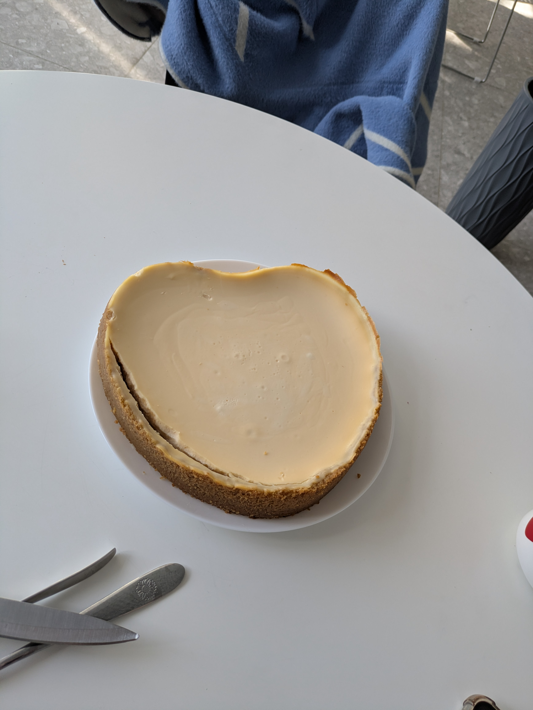
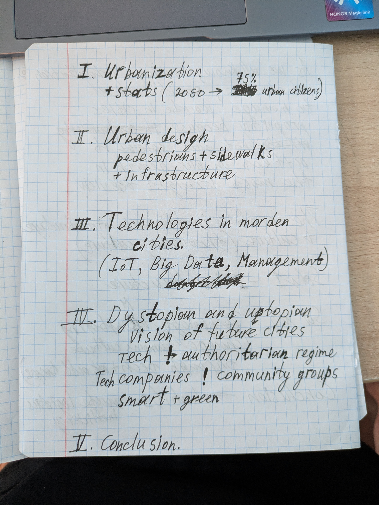

Моя последняя неделя прошла интересно: я успел отпраздновать день рождаения, сходить в китайский ресторан, и заболеть. Из-за болезни я всю неделю пролежал дома, но ничего, успел сделать много классного! 

## My birthday

День рождения я отпраздновал в китайском ресторане, который находится недалеко от моего дома. Я заказал много вкусной еды, и мы с друзьями отлично провели время. Мне подарили чизкейк (мой любимый десерт), и я был очень счастлив.

## Being sick

К сожалению, после дня рождения я заболел. У меня была высокая температура, головная боль и слабость. Я провел всю неделю в постели, но это не помешало мне быть продуктивным. Я читал книги, смотрел фильмы и даже написал несколько статей для моего блога. Я также использовал это время, чтобы поработать над некоторыми проектами, которые давно откладывал.

## Считаете ли вы эту страницу полезной? Подумайте о том, чтобы поделиться 🙌
